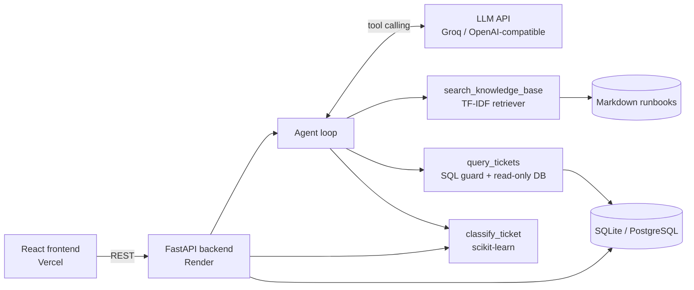

# IT Helpdesk Copilot

An AI assistant for IT support teams. It **answers IT questions from a knowledge base (RAG)**, **classifies new tickets by category and priority (ML)**, lets engineers **ask questions about ticket data in plain English (text-to-SQL agent)**, and shows a **dashboard** of ticket trends.

**Live demo:** _add your Vercel link here_ · **API docs:** _add your Render link here_/docs


## Features

| Feature | How it works |
|---|---|
| **Knowledge-base Q&A (RAG)** | IT runbooks are split into sections, indexed with TF-IDF, and the best matches are passed to the LLM, which answers only from them and cites the articles. |
| **AI agent with tools** | The LLM chooses between three tools: `search_knowledge_base`, `query_tickets` (read-only SQL) and `classify_ticket`. Every tool call is shown in the UI ("How I answered"). |
| **Ticket triage (ML)** | TF-IDF + Logistic Regression models predict **category** (Network, Access, Hardware, Software, Email) and **priority** (High, Medium, Low) with confidence scores. |
| **Self-service suggestions** | When a ticket is raised, the most relevant runbook section is suggested so users can try a fix first. |
| **Dashboard** | Tickets per day, category × priority, top recurring issues, copilot resolution rate, average resolution time and live model metrics. |
| **Safe SQL** | LLM-written SQL passes three layers of protection (see [Security](#security)). |
| **Offline mode** | Without an LLM key the app still works: chat returns the best-matching article, and triage and dashboard work fully. |

## Architecture



## Tech stack

- **Backend:** Python, FastAPI, SQLAlchemy, scikit-learn, pandas
- **AI:** LLM via any OpenAI-compatible API (Groq `llama-3.3-70b-versatile` by default), tool calling, RAG
- **Database:** SQLite (default) or PostgreSQL
- **Frontend:** React (Vite), Recharts, react-markdown
- **DevOps:** GitHub Actions CI, Docker, Render (API), Vercel (frontend)

## Run locally

**Requirements:** Python 3.11+ and Node 18+.

### 1. Backend

```bash
cd backend
python -m venv .venv
source .venv/bin/activate        # Windows: .venv\Scripts\activate
pip install -r requirements-dev.txt
cp .env.example .env             # then paste your LLM key into .env
python scripts/train_classifier.py
uvicorn app.main:app --reload
```

The API runs at http://localhost:8000 (interactive docs at http://localhost:8000/docs).
On first start it creates the database and loads the sample tickets.

**LLM key:** create a free key at [console.groq.com/keys](https://console.groq.com/keys) and set `LLM_API_KEY` in `backend/.env`. To use another provider, change `LLM_BASE_URL` and `LLM_MODEL` (any OpenAI-compatible chat completions API with tool calling works). If a model has been retired, pick a current one from your provider's model list.

### 2. Frontend

```bash
cd frontend
npm install
cp .env.example .env             # VITE_API_URL=http://localhost:8000
npm run dev
```

Open http://localhost:5173.

### 3. Tests

```bash
cd backend
python -m pytest -q
```

Tests cover the SQL guard, the read-only connection, all API endpoints, and the agent loop (with a mocked LLM).

## Deploy

**Backend on Render**
1. New > Web Service > connect this repo. Root directory: `backend` (or use New > Blueprint, which reads `render.yaml`).
2. Build command: `pip install -r requirements.txt && python scripts/train_classifier.py`
3. Start command: `uvicorn app.main:app --host 0.0.0.0 --port $PORT`
4. Environment variables: `LLM_API_KEY`, `PYTHON_VERSION=3.12.7`, and `ALLOWED_ORIGINS=https://<your-app>.vercel.app`

**Frontend on Vercel**
1. New Project > import this repo. Root directory: `frontend` (framework preset: Vite).
2. Environment variable: `VITE_API_URL=https://<your-api>.onrender.com`

> Render's free tier sleeps after inactivity, so the first request can take ~30 seconds. The SQLite database is re-created and re-seeded on each deploy. Set `DATABASE_URL` to a PostgreSQL database (e.g. Render Postgres or Neon) to persist new tickets.

## Train on a real dataset

The repo includes a generated sample dataset (`backend/data/tickets.csv`, created by `scripts/generate_tickets.py`) so the project runs out of the box. To get realistic accuracy numbers, train on a public IT-ticket dataset, e.g. from Kaggle:

```bash
python scripts/train_classifier.py --csv path/to/dataset.csv \
    --text-cols "Document" --category-col "Topic_group" --priority-col ""
```

Change the column names to match your dataset. Metrics are saved to `models/metrics.json` and shown on the dashboard.

## Security

The agent can read ticket data but can never change it:

1. **SQL guard** (`app/sql_guard.py`): only a single `SELECT`/`WITH` statement is accepted; comments, multiple statements and write/DDL keywords (`DELETE`, `DROP`, `ATTACH`, `PRAGMA`, ...) are rejected.
2. **Row limit:** every query is wrapped so at most 50 rows are returned.
3. **Read-only connection:** SQLite is opened with `mode=ro`; PostgreSQL runs in a `READ ONLY` transaction with a 5-second statement timeout.

Rejected queries are returned to the LLM as an error, so it can explain the refusal. Other measures: CORS restricted to the frontend origin, input length limits, and the LLM key kept in environment variables.

## Project structure

```
backend/
  app/
    main.py          FastAPI routes (chat, tickets, classify, stats)
    agent.py         LLM tool-calling loop and tools
    retriever.py     Markdown chunking + TF-IDF search (RAG)
    classifier.py    Training, evaluation and prediction
    sql_guard.py     SQL validation
    db.py            Database schema, seeding, read-only queries
    llm.py           OpenAI-compatible API client
  data/kb/           Knowledge-base articles (Markdown)
  data/tickets.csv   Sample ticket dataset
  scripts/           Dataset generator and training script
  tests/             pytest suite
frontend/
  src/components/    Chat, NewTicket, Dashboard
```

## Screenshots

| Ticket triage | Dashboard |
|---|---|
|  |  |

## Possible improvements

- Neural embeddings (e.g. `bge-small`) with a vector database instead of TF-IDF
- Evaluation set for RAG answer quality
- Authentication and per-user ticket history
- Ticket status updates and engineer assignment
